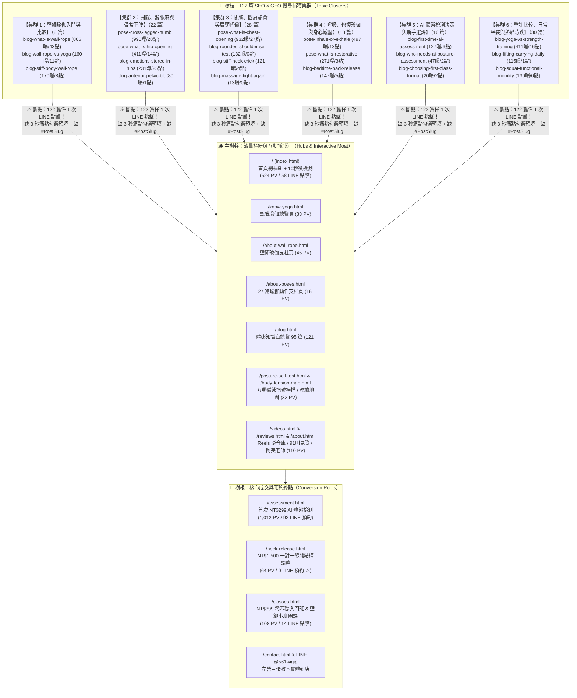

# 鑫彥瑜珈運動館（`sinyanyoga.com.tw`）— SEO × GEO × 轉換 6 層作戰總規紀錄

> **建立／最後實測時間**：`2026-11-20`
> **最高指導原則**：
> 1. **第 0 條數據防呆鐵律**：GSC 資源固定為 `sc-domain:sinyanyoga.com.tw`；GA4 固定為 `ga4-yoga`（Property ID：`547750681`，目標網域：`sinyanyoga.com.tw`）。每次拉取 GA4 報表第一步必驗 `hostName == sinyanyoga.com.tw`，剔除 `localhost` / `127.0.0.1` 測試雜訊。
> 2. **先實測現況、禁止做白工**：所有頁面修改前必先查驗線上真實原始碼與 `Last-Modified`，已到位項目直接標記「✅ 已完成／進入觀察期」。
> 3. **6 層誠實回報鐵律**：每次交付必標註「① 完成 6 層地圖的第幾層、② 該層真實進度（禁止把單頁微調虛報成全站 95%）、③ 下一層最大瓶頸」。
> 4. **黃金標竿母版鐵律**：比照台灣撥筋站以 `臉部撥筋課程-學習方案/` 作為導覽列母版，瑜珈站以 **`classes.html`（8 段完整版＋3 支實拍短影音嵌入＋文字摘錄＋3 秒預填預約）** 作為全站第 1 號黃金標竿母版，經使用者驗收後再橫向複製到其餘 5 個導覽主頁與高流量主角文章。

---

## 📊 第 0 條鐵律驗證紀錄（GA4 `hostName` 實測核對）

- **查驗區間**：近 90 天（`2026-08-21` 至 `2026-11-18`）
- **GA4 Property ID**：`547750681`（透過 `ga4-yoga` MCP 驗證）

| `hostName` | `screenPageViews` | `activeUsers` | `sessions` | 判定處置 |
| :--- | :---: | :---: | :---: | :--- |
| **`sinyanyoga.com.tw`** | **3,024** | **1,538** | **1,945** | ✅ **唯一分析目標網域（確認無誤）** |
| `localhost` | 155 | 7 | 31 | ❌ 本地開發雜訊（分析時予以剔除） |
| `127.0.0.1` | 66 | 12 | 23 | ❌ 本地開發雜訊（分析時予以剔除） |

---

## 🗺️ 全站 6 層作戰進度總覽（2026-11-20 誠實校準版）

| 層級 | 作戰模組 | 目前真實進度 | 狀態摘要（已完成 vs 尚未補齊） |
| :---: | :--- | :---: | :--- |
| **第 1 層** | **技術與 GEO 地基** | **92%** | ✅ 首頁 `<title>` 改為在地核心詞置前、補建 `.nojekyll` 修復 `/.well-known/ai.txt` 為 HTTP 200、294 處 `href="index.html"` 收斂為 `./`、夜間深色模式 `.sec-head h2` 隱形 Bug 修復。 ⏳ 尚待：`geo audit` 上線後重跑驗收、`classes.html` 以外頁面之 `VideoObject` 實景播放器覆蓋。 |
| **第 2 層** | **全站架構與內耗清查** | **78%** | ✅ 已完成全站 127 頁樹狀分層盤點（6 樹根 → 12 樞紐 → 5 樹幹唯一主角頁 → 106 樹枝）、`ai-assessment.html` 退役導向 `assessment.html`、壁繩與 AI 體態 2 大內耗區錨點切分。 ⏳ 尚待：將 5 條樹幹共 106 篇樹枝文的導流內鏈全面收斂指向各自「唯一主角頁」＋ 70/30 擴寫清單執行。 |
| **第 3 層** | **黃金機會詞與零點擊防禦** | **62%** | ✅ 已完成 Top 5 高曝光金礦頁＋4 篇預警文（共 9 篇）之問句 H2、RAG 原子答案塊與 HTML `<table>` 改版；`classes.html` 已補齊原生 HTML 4 大方案規格總表。 ⏳ 尚待：其餘 5 大樹幹主角頁（骨盆前傾、膝髖連動、久坐失憶臀、熟齡防跌平衡、深蹲卡關）深度改寫＋嵌入對應實拍短影音。 |
| **第 4 層** | **實體權威（Entity Graph）與影音信號** | **65%** | ✅ 全站 106 篇 `BlogPosting.author` 連回 `about.html#amei`（黃淑美／阿美老師）；四大核心頁 `sameAs` 統一對齊 FB + IG (`lanyingmin0209`) + GBP；`classes.html` 已實嵌 3 支 MP4 短影音＋Video Transcript＋`VideoObject/Clip`。 ⏳ 尚待：**實景影音覆蓋率目前僅 4 / 127 頁（`index`, `videos`, `blog`, `classes`）**，需將 9 支實拍 Reels 陸續嵌入其餘 4 個導覽頁與 Top 8 主角文章。 |
| **第 5 層** | **防流失轉換漏斗與黃金標竿母版** | **58%** | ✅ **第 1 號導覽列黃金標竿完整版 `classes.html`（比照台灣站 8 段架構）已完成並通過 320/375/390/1280px 亮／暗雙模式零跑版實測**；`assessment.html` 4 拍改版完成；122 篇知識文掛載 3 條痛點分流預填引擎。 ⏳ 尚待：依 `classes.html` 黃金母版橫向升級其餘 5 個導覽主頁（`about-wall-rope`, `assessment`, `neck-release`, `about`, `reviews`）＋填入 Microsoft Clarity ID。 |
| **第 6 層** | **閉環追蹤與飛輪迭代** | **55%** | ✅ `site.js`、`assessment.html`、`classes.html` 已串聯 `#PostSlug` / `#classes` 來源代碼與 GA4 互動事件。 ⏳ 尚待：全站導覽頁與影音嵌入到位後，進行 14～28 天 GSC CTR × GA4 轉換率實測複盤與 Clarity 熱圖驗屍。 |

---

## 🔍 第一步：全站 6 層真實數據體檢報告（只查不改）

### 1. 第 1 層（技術與 GEO 地基）實測證據

#### ① `geo audit --url https://sinyanyoga.com.tw --no-plugins` 實測結果
- **總分**：**91 / 100（Band: `excellent`）**
- **各維度得分明細**：
  - `google_ai`：**20 / 20**（✅ 已完成：HTTP 200、無 snippet 限制、Canonical 正確、日期一致、Author 宣告、37 條可爬連結、Viewport 正常、Sitemap 宣告正常）
  - `robots_txt`：**14 / 14**（✅ 已完成：`GPTBot`, `OAI-SearchBot`, `ChatGPT-User`, `ClaudeBot`, `Claude-SearchBot`, `PerplexityBot`, `Google-Extended`, `Applebot-Extended` 等 27 個 AI 爬蟲全數開放，無 CDN 阻擋）
  - `llms_txt`：**6 / 6**（✅ 已完成：`/llms.txt` 883 字、含 H1、Blockquote 摘要、4 大區塊、12 條核心連結；另有 `/llms-full.txt`）
  - `content`：**14 / 14**（✅ 已完成：首頁圖片 Alt 覆蓋率 **100% [6/6]**、含數據與外部權威引用）
  - `meta_tags`：**11 / 11**（✅ 已完成：Title、Description、Canonical、OG 與 Twitter 標籤齊全）
  - `signals`：**6 / 6**（✅ 已完成：`lang="zh-Hant"`、`/rss.xml`、新鮮度時間戳 `2026-11-13`）
  - `schema_jsonld`：**12 / 14**（⚠️ 待補強：首頁含 `HealthClub`, `Person`, `WebSite`, `WebPage`, `Service`, `VideoObject`×3, `FAQPage`，但缺少互動檢測工具之 `WebApplication` Schema 與影片 `Clip` 秒數錨點）
  - `brand_entity`：**8 / 12**（⚠️ 待補強：缺少權威外部圖譜連結與跨頁品牌名統一）
  - `ai_discovery`：**1 / 3**（⚠️ 待補強：已有 `/ai/summary.json` 與 `/ai/faq.json`，但缺少 `/.well-known/ai.txt` 與 `/ai/service.json`）
  - `negative_penalty`：**-1**（偵測到彈窗訊號 `exit-modal`）
  - `rag_chunk`（資訊檢索切塊準備度）：**35 / 100**（⚠️ 首頁區塊平均字數偏短、缺少首段標準定義型 Answer Capsule）

#### ② 品牌名一致性清查（Brand Coherence）
- 實測全站 138 個 HTML 檔案的 `<title>`、內文與 JSON-LD，發現**三種品牌名稱混用**：
  1. `鑫彥瑜珈運動館`（用於首頁 `<title>`、`HealthClub` Schema、`reviews.html`）
  2. `鑫彥瑜珈`（用於 `blog-*.html` 的 `<title>` 尾綴、`og:site_name`、導覽列）
  3. `鑫彥瑜伽館`（用於 `pose-*.html` 的 `<title>` 尾綴，以及 **122 篇文章 `BlogPosting.author.name`**）
- **診斷**：應統一主實體名稱為「**鑫彥瑜珈運動館（鑫彥瑜珈）**」，並消滅 `鑫彥瑜伽館` 這個不一致的第三變體。

#### ③ 首頁與核心文章線上 `<title>` 實測（檢查「品牌名置前」問題）
實測抓取線上正式環境（`Last-Modified: Fri, 13 Nov 2026 06:54:12 GMT`）與全站 138 頁原始碼：

| 頁面網址 | 線上實際 `<title>` | 品牌名位置 | 狀態判定 |
| :--- | :--- | :---: | :--- |
| **`https://sinyanyoga.com.tw/`（首頁）** | **`鑫彥瑜珈運動館 \| 高雄左營瑜珈課・壁繩瑜珈與 AI 體態檢測`** | ❌ **最前面（前 7 字被品牌名佔據）** | 🔴 **唯一違規頁！** 在手機 SERP 前 28 字黃金視覺區被品牌名吃掉地域與服務核心詞，且首頁在「高雄瑜珈 (pos 8.3)」、「瑜珈教室 (pos 7.2)」點擊率為 **0%**。 |
| `https://sinyanyoga.com.tw/assessment.html` | `AI 體態檢測｜高雄左營・原價 NT$699・首次 NT$299｜鑫彥瑜珈` | ✅ 最後面 | ✅ 已完成／進入觀察期 |
| `https://sinyanyoga.com.tw/blog-arm-flab-rounded-shoulders.html` | `手臂放下來就鬆垮？蝴蝶袖可能跟姿勢有關，不只是脂肪｜鑫彥瑜珈` | ✅ 最後面 | ✅ 已完成／進入觀察期 |
| `https://sinyanyoga.com.tw/blog-knee-hip-connection.html` | `膝蓋卡卡不一定在膝蓋？先看懂髖關節活動度與下肢代償的關係｜鑫彥瑜珈` | ✅ 最後面 | ✅ 已完成／進入觀察期 |
| `https://sinyanyoga.com.tw/blog-massage-tight-again.html` | `為什麼你按摩完，隔天又緊回去了？｜鑫彥瑜珈` | ✅ 最後面 | ✅ 已完成／進入觀察期 |
| `https://sinyanyoga.com.tw/blog-choosing-first-class-format.html` | `團課、一對一、零基礎入門班，第一次來該選哪一種？｜鑫彥瑜珈` | ✅ 最後面 | ✅ 已完成／進入觀察期 |
| `https://sinyanyoga.com.tw/blog-anterior-pelvic-tilt.html` | `骨盆前傾就等於小腹凸？先看懂骨盆位置與核心用力的真實關係｜鑫彥瑜珈` | ✅ 最後面 | ✅ 已完成／進入觀察期 |

> **小結**：全站 138 個 HTML 檔案中，137 頁皆已將品牌名置於最後；**唯獨首頁 `index.html` 把「鑫彥瑜珈運動館 | 」放在最前面**！

#### ④ GSC 舊 `/amp/`、參數頁與重複網址清查
- **GSC 實測（近 180 天所有曝光網址共 118 條）**：
  - 舊 `/amp/` 網址：**0 條**（✅ 完全乾淨）
  - `?` 參數頁或 `#` 錨點污染網址：**0 條**（✅ 完全乾淨）
  - `http://` 或 `www.` 重複網域：**0 條**（✅ 完全乾淨）
- **⚠️ 但在 GA4 與本機架構中抓出 2 個「隱形重複網址分裂」**：
  1. **首頁網址雙胞胎分裂（`/` vs `/index.html`）**：因為全站導覽列 `<a class="brand" href="index.html">` 與選單連結寫成 `index.html` 而非 `./` 或 `/`，導致 GA4 近 90 天流量分裂為 `/`（384 PV）與 `/index.html`（140 PV）兩條路徑。
  2. **多版本實驗落地頁並存**：根目錄存在 `assessment-v2.html`, `assessment-v3.html`, `assessment-v4.html`, `ai-assessment.html`（83 PV）、`neck-release-v1.html`, `neck-release-v3.html`, `shoulder-checkup-v1.html`（8 PV）。雖這 10 頁已正確設為 `<meta name="robots" content="noindex">` 且排除於 `sitemap.xml` 外（✅ 防呆已做好），但廣告或站內殘留流量進到 `/ai-assessment.html`（83 PV）時平均停留僅 9 秒且 0 轉換。

---

### 2. 第 2 層（全站架構與內耗清查）實測證據

#### ① 全站關鍵字內耗（Keyword Cannibalization）
從近 90 天 GSC `query + page` 交叉報表（共 447 筆組合）中，抓出 **54 個查詢詞有 2 頁以上同時競爭**。最嚴重的 **3 大非品牌內耗重災區** 如下：

1. **【重災區 A：「壁繩瑜珈／壁繩／壁繩瑜伽／牆繩瑜伽／壁繩瑜珈好處」詞簇（合計 969 次曝光）】**
   - **互搶頁面（多達 6 頁同時搶同一批詞）**：
     - `blog-what-is-wall-rope.html`（「壁繩瑜珈」358 曝 / 22 點，pos 3.7；「壁繩」78 曝 / 3 點，pos 7.5；「壁繩瑜伽」65 曝 / 5 點，pos 5.2）
     - `about-wall-rope.html`（「壁繩」111 曝 / 8 點，pos 3.4；「壁繩瑜伽」48 曝 / **0 點**，pos 5.4；「壁繩瑜珈」28 曝 / 1 點，pos 4.2；「壁繩瑜珈好處」12 曝 / **0 點**，pos 8.2）
     - `blog-wall-rope-vs-yoga.html`（「壁繩瑜珈」57 曝 / 2 點，pos 4.6；「壁繩瑜伽」14 曝 / **0 點**，pos 6.4）
     - `blog-stiff-body-wall-rope.html`（「壁繩」28 曝 / 3 點，pos 5.4；「壁繩瑜珈好處」18 曝 / **0 點**，pos 6.9）
     - `know-yoga.html`（「壁繩瑜珈」20 曝 / **0 點**，pos 2.4；「牆繩瑜伽」7 曝 / **0 點**，pos 1.0）
   - **內耗診斷**：主支柱頁 `about-wall-rope.html` 與新手流程文 `blog-what-is-wall-rope.html` 定位重疊，導致搜尋「壁繩」時出 `about-wall-rope.html`，搜尋「壁繩瑜珈」時卻出 `blog-what-is-wall-rope.html`，搜尋「壁繩瑜珈好處」時兩篇都在第 7～8 名互扯後腿（0 點擊）。

2. **【重災區 B：「AI體態／AI體態是什麼／AI體態檢測」詞簇（合計 65 次曝光，卻是 0 點擊！）】**
   - **互搶頁面（5 頁互搶，結果主力成交頁 `assessment.html` 反而排在最後！）**：
     - `blog-first-time-ai-assessment.html`（「ai體態」28 曝 / 0 點，pos 8.2；「ai體態是什麼」11 曝 / 0 點，pos 6.2；「ai體態檢測」6 曝 / 0 點，pos 4.5）
     - `blog-who-needs-ai-posture-assessment.html`（「ai體態」10 曝 / 0 點，pos 8.5；「ai體態檢測」2 曝 / 0 點，pos 1.0）
     - `blog-no-pain-ai-posture-assessment.html`（「ai體態是什麼」3 曝 / 0 點，pos 6.0）
     - `blog-ai-assessment-not-just-numbers.html`（「ai體態是什麼」2 曝 / 0 點，pos 6.0）
     - **`assessment.html`（核心預約頁）**：在「ai體態是什麼」僅 **1 曝 / 0 點（pos 10.0）**，在「ai體態」與「ai體態檢測」甚至被自己的部落格文章擠出榜外！

3. **【重災區 C：「高雄瑜珈／北高雄瑜珈推薦／附近瑜珈教室／高雄瑜珈推薦」在地商業詞簇（合計 132 次曝光，僅 3 點擊）】**
   - **互搶頁面**：`/`（首頁）、`/assessment.html`、`/contact.html`、甚至連場地租借頁 `/rental.html`（在「附近瑜珈教室」搶走 11 次曝光、pos 9.1、0 點擊！）都在互搶本地搜尋意圖。

#### ② 衰退文清查（Content Decay：近 90 天 vs 前 90 天）
- **實測結論**：✅ **全站無實質內容流量衰退（點擊零流失）**！
  - 對比前 90 天（`2026-05-23`～`08-20`，67 頁有曝光）與近 90 天（`2026-08-21`～`11-18`，118 頁有曝光），全站正處於高速爬升期（例如首頁曝光從 810 升至 2,798；`blog-what-is-wall-rope.html` 從 74 升至 865；`pose-cross-legged-numb.html` 從 35 升至 990）。
  - 僅有 **4 篇舊文「曝光微增、但平均排名下滑且維持 0 點擊」**（潛在排名滑落預警）：
    1. `blog-rounded-shoulders.html`：曝光 7 → 101，但排名從 **7.0 掉到 12.3**
    2. `blog-who-needs-ai-posture-assessment.html`：曝光 6 → 47，但排名從 **5.0 掉到 11.0**
    3. `pose-gentle-backbend-start.html`：曝光 1 → 59，但排名從 **2.0 掉到 7.3**（0 點擊）
    4. `blog-hunchback-height.html`：曝光 13 → 24，排名從 **5.5 掉到 6.8**（0 點擊）

#### ③ 秒跳重災區（GA4 `hostName == sinyanyoga.com.tw`，平均每人互動時間 < 15 秒）
| 頁面路徑 | 瀏覽量 (PV) | 活躍用戶 | 平均每人互動秒數 | 跳出率 (Bounce Rate) | 秒跳診斷 |
| :--- | :---: | :---: | :---: | :---: | :--- |
| **`/assessment.html`（舊 $199 + 現 $299 合計）** | **1,012** | **775** | **10.8s ～ 13.0s** | **64.3% ～ 66.0%** | 🔴 **全站最大流量落地頁**（承接廣告與站內導流），雖有 92 次 LINE 預約點擊，但 **65% 用戶在 11 秒內跳出**，且僅觸發 1 次 `page_engaged_10s` 與 0 次 `scroll_depth_milestone`！ |
| **`/ai-assessment.html`（舊版實驗頁）** | **83** | **65** | **9.0s** | **64.1%** | 🔴 **83 PV 卻是 0 次 LINE 點擊**！仍在消耗流量卻無轉換。 |
| `/pose-gentle-backbend-start.html` | 13 | 13 | **6.2s** | 69.2% | 🟠 缺少首屏吸睛痛點切入與結構化比較表，用戶進站 6 秒即跳出。 |
| `/blog-who-needs-ai-posture-assessment.html` | 9 | 7 | **7.9s** | 22.2% | 🟠 決策分流文，讀完 8 秒未點擊 CTA。 |
| `/shoulder-checkup-v1.html`（實驗頁） | 8 | 8 | **1.5s** | 62.5% | 🟠 實驗落地頁秒跳（0 轉換）。 |
| `/blog-choosing-first-class-format.html` | 7 | 2 | **5.5s** | 85.7% | 🟠 選課比較文，跳出率 85.7%。 |
| `/blog-massage-tight-again.html` | 5 | 5 | **0.0s** | 40.0% | 🟠 按摩反覆緊繃文，未改版為深度解剖量化結構（與 `blog-arm-flab` 相比內容明顯單薄，僅 131 行）。 |

#### ④ 瑜珈站目前「樹狀架構圖（樹根預約頁 → 主樹幹主題集群 → 樹枝）」

---

### 3. 第 3 層（黃金機會詞與 AI 零點擊防禦）實測證據

從近 90 天 GSC 撈出**「高曝光、排名 4–15、極低點擊（CTR < 3%）」**或**「排名前 3 卻被 AI 摘要吃掉點擊」**的 6 大黃金機會詞簇：

| 優先序 | 目標頁面 | 核心扇出機會詞（GSC 90天實測數據） | 目前表現 | 問題診斷與升級方向 |
| :---: | :--- | :--- | :--- | :--- |
| **1** | `pose-cross-legged-numb.html` （全站曝光第 2 名：990 曝） | • `盤腿坐腳麻`（67 曝 / **0 點**，pos 5.9） • `為什麼盤腿坐會腳麻`（26 曝 / **0 點**，pos 5.3） • `盤腿腳麻`（17 曝 / **0 點**，pos 9.5） • `盤腿容易腳麻`（10 曝 / **0 點**，pos 10.0） | 合計 120+ 精準長尾曝光卻 **0 點擊**（整體 CTR 僅 2.8%） | 內文 H2 為感性標題，未直接命中「為什麼盤腿坐會腳麻？」問句，且首段缺 100 字量化原子答案塊（髖外旋角度 < 45°、坐骨墊高 5–10cm、腓總神經壓迫機轉）與 10 秒左右髖高低自測。 |
| **2** | `pose-what-is-chest-opening.html` （全站曝光第 3 名：932 曝） | • `開胸`（282 曝 / 6 點，**CTR 2.13%**，pos 7.3） • `如何自己開胸`（39 曝 / 1 點，**CTR 2.56%**，pos 7.5） • `開胸瑜珈`（14 曝 / 1 點，pos 8.7） | 932 曝光僅 27 點擊（**CTR 2.90%**），且全頁無 `<table>` 比較表！ | 缺少「如何自己安全開胸？」H2 問句與原生 HTML `<table>`（硬夾肩胛骨代償 vs 胸小肌鬆解＋胸椎伸展對照表），且 GA4 35 PV 中 **LINE 預約點擊為 0**。 |
| **3** | `pose-what-is-restorative.html` （271 曝 / 僅 3 點） | • `修復瑜伽`（80 曝 / **0 點**，pos 8.0） • `修復瑜珈`（32 曝 / **0 點**，pos 12.9） • `修復瑜伽是什麼`（21 曝 / **0 點**，pos 9.9） | 271 曝光僅 3 點擊（**CTR 1.11%**），核心詞全數 0 點擊！ | `<title>` 尾綴還是舊的 `｜鑫彥瑜伽館`，且內文缺少具體量化數據（如：停留 5–15 分鐘、迷走神經與心率變異度 HRV 調節、與陰瑜伽／壁繩支撐的量化比較）。 |
| **4** | `pose-what-is-hip-opening.html` （411 曝 / 14 點） | • `為何要開髖`（36 曝 / 2 點，pos 6.4） • `為什麼要開髖`（36 曝 / 1 點，**CTR 2.78%**，pos 8.4） • `開髖`（15 曝 / **0 點**，pos 16.3） | 411 曝光，CTR 3.41%，且全頁**無 `<table>` 比較表**、GA4 36 PV **0 轉換** | 需將 H2 直接對齊「為什麼要開髖？」並補上 HTML `<table>`（髂腰肌縮短 vs 臀肌失憶 vs 內收肌緊繃三型對照表）與 10 秒單側髖外旋自測。 |
| **5** | `blog-what-is-wall-rope.html` ＋ `about-wall-rope.html` | • `壁繩瑜珈`（418 曝 / 25 點，**pos 3.7**，CTR 5.98%） • `壁繩`（204 曝 / 13 點，pos 5.1） • `壁繩瑜伽`（96 曝 / 5 點，pos 4.4） • `牆繩瑜伽`（54 曝 / 2 點，**pos 3.0，CTR 3.70%**） • `壁繩瑜珈好處`（31 曝 / 1 點，pos 6.9） | 雖是全站流量王（合計 1,299 曝、108 PV），但 **GA4 兩頁合計 LINE 預約點擊 = 0**！ | 兩頁權責未切分（內耗），且 `blog-what-is-wall-rope.html` 連 `data-line-message` 都沒設，讀者看完 56.8 秒直接離開，白白流失全站最大精準流量！ |
| **6** | `/`（首頁）＋ `assessment.html` | • `高雄瑜珈`（27 曝 / **0 點**，pos 8.3） • `瑜珈教室`（23 曝 / **0 點**，pos 7.2） • `高雄瑜伽`（19 曝 / **0 點**，pos 13.1） • `高雄瑜珈推薦`（14 曝 / **0 點**，pos 9.6） • `ai體態`（38 曝 / **0 點**，pos 8.3） | 高雄在地高商業意圖詞已排進第一頁（7～9 名），卻是 **0 點擊**！ | 首頁 `<title>` 品牌名放最前面擋住「高雄左營瑜珈教室・壁繩瑜珈與 AI 體態檢測」；而 `assessment.html` 被部落格文分食了 `ai體態` 權重。 |

---

### 4. 第 4 層 & 第 5 層（實體權威與轉換工具盤點）實測證據

#### ① Microsoft Clarity 安裝狀態
- **線上與本機 138 頁實測結果**：❌ **全站 0 安裝（0 / 138 頁，`site.js` 亦無 Clarity 追蹤碼）**。
- **影響**：目前 `/assessment.html` 高達 65% 的跳出率與 11 秒停留、以及知識文章讀完不點 CTA 的熱區斷點，完全沒有螢幕錄影（Session Recordings）與點擊熱圖（Heatmaps）可供視覺化屍檢。

#### ② GA4 事件與轉換漏斗現況
- **線上實測**：透過 `site.js` 動態載入 GA4（`G-6X3PD7NMMG`）與 Meta Pixel（`1594348069032790`），全站 135 個正式頁皆正常載入。
- **已部署自訂事件（近 90 天 `sinyanyoga.com.tw` 實測觸發量）**：
  - `line_reservation_click`：**153 次**（97 人）— 但 **94% 集中在 `/assessment.html` (92 次) 與首頁 (33 次)**！
  - `line_contact_click`：**34 次**（15 人）
  - `scroll_depth_milestone`：**198 次**（63 人）
  - `page_engaged_10s`：**88 次**（63 人）
  - `posture_scan_click`：**9 次**（4 人）
- **🔴 致命轉換斷點（數據鐵證）**：
  - **全站 122 篇部落格與動作知識文章（`blog-*.html` + `pose-*.html`）在近 90 天帶來最高搜尋曝光與長時閱讀（如 `blog-what-is-wall-rope.html` 63 PV / 平均互動 56.8 秒、`blog-emotions-stored-in-hips.html` 46 PV / 平均互動 40.3 秒、`pose-cross-legged-numb.html` 42 PV / 平均互動 83.5 秒），但全部 122 篇文章加起來，竟然只產生 1 次 `line_reservation_click`！**
  - **原因屍檢**：
    1. 122 篇文章中有 **120 篇完全沒有設定 `data-line-message`**（點擊 CTA 時沒有預填訊息，桌機直接跳空白 `lin.ee` 加好友頁，也沒有 `#文章代碼`）。
    2. 文末 CTA 全站千篇一律塞同一張死板的「預約首次 NT$299 AI 體態檢測」黑底卡片，**缺乏「物理極限斷點＋10 秒鏡前／坐姿單側自測」**，也**沒有「3 秒痛點勾選 → 自動組裝預填 LINE 訊息」**的互動防流失機關！
    3. 甚至連高單價主力頁 `/neck-release.html`（NT$1,500 一對一調整，64 PV，平均停留 35.9 秒）在近 90 天的 **`line_reservation_click` 也是 0 次**！

#### ③ `Organization` / `Person` Schema 與 `sameAs` 社群連結一致性盤點
- **`sameAs` 覆蓋率與完整度**：
  - 全站 138 頁中，僅 **4 頁**（`index.html`, `about.html`, `contact.html`, `reviews.html`）的 `HealthClub` Schema 包含 `sameAs`。
  - 且 `sameAs` 內容僅有 2 條：`["https://www.facebook.com/sinyanyoga", "https://maps.google.com/?cid=3869696325150721929"]`，缺少官方 LINE（`https://lin.ee/5rWzdNd`）等外部實體連結。
- **`Person`（阿美老師）與 `Article` 實體圖譜斷鏈**：
  - 首頁 `index.html` 已定義了高品質的 `@type: Person`（`@id: "https://sinyanyoga.com.tw/about.html#amei"`, `name: "黃淑美"`, `alternateName: "阿美老師"`, 含 RYT-200 / RYT-95 / 艾揚格 180+ 小時研習資歷）。
  - **但是！** 打開 `about.html` 本身，裡面的 JSON-LD **竟然沒有定義 `#amei` 的 `Person` 節點**！
  - 更嚴重的是，全站 **122 篇 `blog-*.html` 與 `pose-*.html` 的 `BlogPosting` Schema**，其 `author` 全部寫成 `{"@type": "Organization", "name": "鑫彥瑜伽館"}`（不僅名稱不一致，還把個人專家降格為無資歷的機構名），完全沒有串聯到 `{"@type": "Person", "@id": "https://sinyanyoga.com.tw/about.html#amei", "name": "黃淑美（阿美老師）"}`！這在 YMYL 運動體態領域直接損失了 Google E-E-A-T 與 AI 引擎最看重的專家實體權重。

---

## 🎯 最優先的 3 件核心地雷（Top 3 Core Landmines）

1. **【地雷 1｜第 5 層轉換大失血】全站 122 篇知識文章「有流量、高停留、卻近乎 0 預約（僅 1 次點擊）」＋ 全站未裝 Clarity**
   - **證據**：`blog-what-is-wall-rope.html`（865 曝 / 63 PV / 停留 57 秒）、`pose-cross-legged-numb.html`（990 曝 / 42 PV / 停留 84 秒）、`pose-what-is-chest-opening.html`（932 曝 / 35 PV）等高流量知識文，以及 `/neck-release.html`（64 PV），因為缺少「10 秒單側代償自測斷點 ＋ 3 秒痛點勾選自動預填 LINE `oaMessage`（含 `#文章ID`）」，且 120 篇文章連基礎 `data-line-message` 都沒掛，導致讀者看完免費教學拍拍屁股就走，轉換率趨近 0%；同時全站 0/138 頁安裝 Microsoft Clarity，且 `/assessment.html`（1,012 PV）有 65% 用戶在 11 秒內跳出卻無熱圖可看。
2. **【地雷 2｜第 2 & 3 層流量內耗與零點擊流失】Top 5 高曝光流量王（盤腿麻 990 曝、開胸 932 曝、壁繩 865 曝、開髖 411 曝、修復瑜伽 271 曝）陷入「長尾詞 0 點擊」與「多頁互搶內耗」**
   - **證據**：「盤腿坐腳麻（120+ 曝 0 點）」、「修復瑜伽（133 曝 0 點）」、「如何自己開胸（CTR 2.5%）」、「AI體態（65 曝 0 點，5 篇部落格把主力頁 `assessment.html` 擠到第 10 名）」、「壁繩瑜珈（6 頁互搶）」。文章 H2 未對齊 GSC 真實扇出問句，且舊制 `pose-*.html` 缺首段 100 字量化 RAG 原子答案塊與結構化 `<table>`。
3. **【地雷 3｜第 1 & 4 層首頁標題違規與實體圖譜斷鏈】首頁 `<title>` 品牌名置前（吃掉高雄在地詞點擊）＋ 導覽列 `index.html` 分裂首頁權重 ＋ 122 篇文章 `Author` 實體與 `about.html#amei` 斷鏈**
   - **證據**：首頁是全站 138 頁中唯一把 `鑫彥瑜珈運動館 | ` 放在 `<title>` 最前面的頁面，導致「高雄瑜珈 (pos 8.3)」、「瑜珈教室 (pos 7.2)」0 點擊；導覽列指向 `index.html` 造成 GA4 分裂出 140 PV 的 `/index.html`；且 122 篇文章作者寫成不一致的 `鑫彥瑜伽館`，未連回 `about.html#amei` 阿美老師 `Person` 實體。

---

## 🏆 黃金標竿母版制度（比照台灣撥筋站 `臉部撥筋課程-學習方案/` 8 段架構）

為徹底避免零碎修補、缺乏全站基準，瑜珈站比照台灣撥筋站 `https://bojin-expert.com/臉部撥筋課程-學習方案/`，建立 **8 段黃金標竿完整版母版**，以 **`classes.html`（課程方式與費用方案）** 作為第 1 號標竿頁完成實作與亮／暗雙模式 RWD 驗收：

| 段次 | 黃金標竿必備模組 | 台灣撥筋站對照原件 | 瑜珈站 `classes.html` 實作內容 |
| :---: | :--- | :--- | :--- |
| **第 1 段** | 定位 Hero ＋ 痛點開場 ＋ 信任條 | 課程主標＋三定位＋4.9★ | 「身體很硬、怕跟不上團課？先看懂身體，再選怎麼練」＋Google 4.9★ (91則)＋10年+左營深耕＋壁繩卸載 30%–50%＋不強迫包堂 |
| **第 2 段** | 4 大方案階梯卡片 ＋ 原生 HTML 規格總表 `<table>` | 四梯次課程卡片＋原生規格比較表 | `$299 AI 體態檢測`、`$399 零基礎入門班`、`壁繩瑜伽小團課`、`$1,500 一對一結構調整`＋原生 HTML 規格對照表（適用對象／時長／輔具／費用／下一步） |
| **第 3 段** | 實作拆解 3 步驟（方法論可視化） | 手把手三步拆解 | 校正 01 先看角度再動手（AI 標線）→ 校正 02 壁繩卸重 30%–50%（關節減壓）→ 校正 03 墊邊逐一微調退階 |
| **第 4 段** | **真實課堂／動作實拍影片直接播放 ＋ 文字摘錄 (Transcript)** | 課堂實景影片＋步驟解說 | **實嵌 3 支可直播 HTML5 MP4 短片**（`reel-9.mp4` 椅子式膝代償、`reel-2.mp4` 四足跪姿骨盆代償、`reel-4.mp4` 下樓梯膝內扣）＋可展開 `
` 教學文字摘錄＋完整 `VideoObject` & `Clip` JSON-LD |
| **第 5 段** | 三段式學員真實案例（① 卡點 → ② 課堂怎麼調 → ③ 練完感受） | 學員回饋三段式＋五星驗證 | 3 位具名 Google / FB 5★ 真實學員三段式案例＋外部 Google 商家 / FB 評論查證連結 |
| **第 6 段** | 報名前最常問 5 大 Q&A（含 `FAQPage` Schema） | 報名前常見問題 | 涵蓋筋骨硬、不推銷包堂、AI 檢測 vs 直接上課、舊傷/熟齡安全邊界、零基礎課表時段 |
| **第 7 段** | 3 秒互動勾選（方案＋身體狀態＋時段）→ 自動預填 LINE `#classes` | 互動選擇＋LINE 預填預約 | 點選即組裝含 `#classes` 來源碼之完整詢問文字，手機喚起 `oaMessage`、桌機自動複製＋Toast 提示 |
| **第 8 段** | 「選課之前，先把問題看清楚」雙欄主題集群導流 | 報名前必讀雙欄文章導流 | 左欄「比較上課方式與壁繩入門」＋右欄「對照身體卡點」，把權重精準灌回各樹幹唯一主角頁 |

### 導覽列主頁橫向對齊清單（依 `classes.html` 母版推進）
1. ✅ **`classes.html`**（第 1 號黃金標竿母版 — 已完成 8 段完整架構＋3 支實拍 MP4＋亮暗模式 320/375/390/1280px 零跑版實測）
2. ⏳ **`about-wall-rope.html`**（壁繩瑜伽支柱主頁 — 下一順位：補齊實拍壁繩動作短片＋8 段規格與對比表）
3. ⏳ **`assessment.html`**（AI 體態檢測主力成交頁 — 已完成 4 拍改版，補齊實拍 AI 檢測／對錯短片＋三段式案例＋雙欄導流）
4. ⏳ **`neck-release.html`**（$1,500 一對一肩頸調整頁 — 0 轉換重災區，比照母版補齊實拍影片＋三段案例＋3 秒預填預約）
5. ⏳ **`about.html`**（關於鑫彥與阿美老師 — 補齊實體環境／教學實拍短片＋資歷時間軸＋雙欄導流）
6. ⏳ **`reviews.html`**（學員見證頁 — 升級三段式分類案例＋影片回饋＋直通體驗預填）

---

## 🪪 官方實體檔案庫（Official Entity Profile Archive）

| 實體欄位 | 官方統一標準值（全站 Schema / Footer / `llms.txt` / `ai/summary.json` 唯一口徑） |
| :--- | :--- |
| **主品牌實體名稱** | `鑫彥瑜珈運動館`（簡稱：`鑫彥瑜珈`；禁止再使用 `鑫彥瑜伽館`） |
| **核心專家實體 (`@id`)** | `https://sinyanyoga.com.tw/about.html#amei` — **黃淑美（阿美老師）**（RYT-200 / RYT-95 / 艾揚格壁繩研習 180+ 小時 / 10 年+左營實體教學） |
| **教室地址與電話** | 高雄市左營區新庄仔路 726 號 3 樓（近捷運巨蛋站步行 5–7 分鐘）｜`07-556-7387`｜每日 `09:00–20:30` |
| **官方 `sameAs` 實體圖譜** | • Facebook：`https://www.facebook.com/sinyanyoga` • Instagram：`https://www.instagram.com/lanyingmin0209/` • Google 商家：`https://maps.google.com/?cid=3869696325150721929`（4.9★ / 91 則好評） • 官方 LINE：`@561wigip`（`https://lin.ee/5rWzdNd`） |

---

## 🌳 全站 127 頁樹狀總架構清點（樹根 → 樞紐 → 5 大樹幹唯一主角頁 → 106 篇樹枝）

> **盤點基準**：`sitemap.xml` 實測共 **127 個正式收錄網址**（不含 10 個 `noindex` 實驗頁），嚴格區分為 **6 樹根成交頁 ＋ 12 樞紐／信任／互動頁 ＋ 3 法規頁 ＋ 106 篇主題集群文章（分屬 5 大樹幹，每幹僅設 1～2 個唯一主角頁防止內耗）**。

### 一、樹根層（Conversion Roots，6 頁 — 商業變現與實體到店終點）
1. `index.html`（`/`）— 首頁總樞紐（高雄左營瑜珈教室・壁繩瑜珈與 AI 體態檢測）
2. `classes.html` — 🏆 課程方式與費用方案（**第 1 號黃金標竿母版**）
3. `assessment.html` — 首次 NT$299 AI 體態檢測主力落地頁
4. `neck-release.html` — NT$1,500 一對一肩頸與體態結構調整頁
5. `contact.html` — 左營教室交通、停車、營業時間與聯絡頁
6. `rental.html` — 教室空間出租與開課老師合作招募頁

### 二、樞紐與互動護城河層（Hubs & Trust Moat，12 頁）
- **知識支柱樞紐（5 頁）**：`know-yoga.html`、`about-wall-rope.html`、`about-poses.html`、`blog.html`、`practice-guide.html`
- **互動自測護城河（4 頁）**：`posture-self-test.html`、`body-tension-map.html`、`resources.html`、`beginner-yoga-guide.html`
- **品牌信任與影音庫（3 頁）**：`about.html`、`reviews.html`、`videos.html`
- **法規頁（3 頁）**：`privacy.html`、`terms.html`、`disclaimer.html`

### 三、5 大樹幹「唯一主角頁」與 106 篇樹枝全盤點

#### 🪵 樹幹 1｜壁繩瑜伽與輔具卸載集群（7 篇）
- **🎯 唯一主角頁**：`about-wall-rope.html`（定義／好處／誰適合）＋ `blog-what-is-wall-rope.html`（第一次上課 5 流程，已切分權責指向支柱頁）
- **🌿 樹枝支援文（6 篇）**：
  - `blog-wall-rope-vs-yoga.html`、`blog-stiff-body-wall-rope.html`、`blog-wall-rope-seniors.html`、`blog-wall-rope-anterior-pelvic-tilt.html`、`blog-massage-gun-vs-wall-rope.html`、`blog-honest-limits-wall-rope.html`

#### 🪵 樹幹 2｜上肢・開胸・圓肩駝背與肩頸代償集群（30 篇）
- **🎯 唯一主角頁**：`pose-what-is-chest-opening.html`（開胸與圓肩調整核心，932 曝）＋ `blog-massage-tight-again.html`（肩頸反覆緊繃與代償源頭）
- **🌿 樹枝支援文（28 篇）**：
  - **圓肩／駝背／高低肩（8 篇）**：`blog-rounded-shoulders.html`、`blog-rounded-shoulder-self-test.html`、`blog-rounded-shoulder-where-to-start.html`、`blog-rounded-shoulders-hunchback-uneven-shoulders-different.html`、`blog-hunchback-height.html`、`blog-why-i-look-hunched-in-photos.html`、`blog-why-sit-up-straight-fails.html`、`blog-uneven-shoulders-hips.html`
  - **肩頸／富貴包／3C 低頭／落枕／頭痛（12 篇）**：`blog-neck-hump.html`、`blog-phone-posture.html`、`blog-office-neck-release.html`、`blog-headache-neck.html`、`blog-jaw-tmj-tension.html`、`blog-stiff-neck-crick.html`、`blog-recurring-neck-tightness-not-just-neck.html`、`blog-is-it-frozen-shoulder.html`、`blog-winter-cold-shoulders.html`、`blog-breathing-shoulder-release.html`、`blog-posture-bracing-compensation.html`、`blog-arm-flab-rounded-shoulders.html`
  - **椅子／書包／手部／開胸後彎動作（8 篇）**：`blog-choosing-a-chair.html`、`blog-students-backpack-posture.html`、`blog-hand-wrist-elbow-pain-comparison.html`、`blog-tired-cant-sleep-chest.html`、`pose-chest-tight-front.html`、`pose-backbend-not-folding.html`、`pose-gentle-backbend-start.html`、`pose-protect-wrist-neck-knee.html`

#### 🪵 樹幹 3｜下肢・開髖・盤腿麻・骨盆與護膝集群（30 篇）
- **🎯 唯一主角頁**：`pose-cross-legged-numb.html`（盤腿腳麻 990 曝）＋ `pose-what-is-hip-opening.html`（開髖 411 曝）＋ `blog-anterior-pelvic-tilt.html`（骨盆前傾）＋ `blog-knee-hip-connection.html`（膝蓋與髖代償）
- **🌿 樹枝支援文（26 篇）**：
  - **骨盆／下背／臀肌／女性（9 篇）**：`blog-low-back-core.html`、`blog-dead-butt-glutes.html`、`blog-emotions-stored-in-hips.html`、`blog-pelvic-floor-leaks.html`、`blog-postpartum-menopause-posture.html`、`blog-yoga-period-cramps.html`、`blog-sitting-8-hours.html`、`blog-standing-low-back.html`、`blog-housework-bending.html`
  - **下肢／深蹲／防跌／步態／足弓（10 篇）**：`blog-squat-functional-mobility.html`、`blog-balance-midlife.html`、`blog-feet-shoes-foundation.html`、`blog-walking-gait-posture.html`、`blog-lifting-carrying-daily.html`、`blog-commute-posture.html`、`blog-long-flight-stiffness.html`、`blog-sprain-strain-comeback.html`、`pose-protect-knees.html`、`pose-balance-midline.html`
  - **前彎／腿後／站姿動作（7 篇）**：`pose-forward-fold-toes.html`、`pose-hinge-not-bend.html`、`pose-hip-opening-myths.html`、`pose-tight-hamstrings.html`、`pose-root-through-feet.html`、`pose-standing-foundation.html`、`pose-period-pregnancy-injury.html`

#### 🪵 樹幹 4｜呼吸・修復瑜伽與睡眠減壓集群（10 篇）
- **🎯 唯一主角頁**：`pose-what-is-restorative.html`（修復瑜伽 271 曝）＋ `pose-inhale-or-exhale.html`（呼吸配合 497 曝）
- **🌿 樹枝支援文（8 篇）**：
  - `pose-belly-breathing.html`、`pose-why-breath-matters.html`、`blog-bedtime-back-release.html`、`blog-sleep-position-pillow.html`、`blog-40-min-break.html`、`blog-gentle-movement-stress.html`、`blog-morning-or-evening-practice.html`、`blog-post-illness-stiffness.html`

#### 🪵 樹幹 5｜AI 體態檢測決策・選課比較與觀念破除集群（29 篇）
- **🎯 唯一主角頁**：`blog-first-time-ai-assessment.html`（AI 檢測流程，導流至 `assessment.html`）＋ `blog-choosing-first-class-format.html`（選課分流，導流至 `classes.html`）
- **🌿 樹枝支援文（27 篇）**：
  - **AI 檢測與學習週期決策（14 篇）**：`blog-who-needs-ai-posture-assessment.html`、`blog-ai-assessment-not-just-numbers.html`、`blog-reading-your-assessment-report.html`、`blog-no-pain-ai-posture-assessment.html`、`blog-class-massage-or-ai-assessment.html`、`blog-after-first-yoga-class.html`、`blog-first-class-what-to-bring.html`、`blog-home-practice-vs-studio.html`、`blog-how-long-to-see-results.html`、`blog-first-three-months-journey.html`、`blog-progress-plateau.html`、`blog-maintain-dont-relapse.html`、`blog-restarting-after-a-break.html`、`blog-too-late-to-start.html`
  - **迷思破除與動作哲學（13 篇）**：`blog-yoga-vs-strength-training.html`、`blog-yoga-vs-stretching.html`、`blog-yoga-myths-busted.html`、`blog-overstretching-risk.html`、`blog-forward-head-daily.html`、`blog-posture-looking-older.html`、`pose-what-is-asana.html`、`pose-movement-categories.html`、`pose-alignment-over-depth.html`、`pose-core-not-situps.html`、`pose-no-pain-no-gain-myth.html`、`pose-roll-up-spine.html`、`pose-advanced-poses-needed.html`

### 四、70 / 30 擴寫鐵律（避免發新文自我內耗）
- **70% 精力鎖死舊文翻新＋實景影片嵌入**：優先翻修上述 5 大樹幹主角頁與排名 4–15 的既有樹枝文（補問句 H2、RAG 原子答案塊、HTML `<table>`、實拍短影音）。
- **30% 精力僅允許開「目前 127 頁完全沒有」的新切入長尾需求**（如高雄在地社群／熟齡族群／特定生活場景新問句），開文前必先核對上方 106 篇清單，確認無重疊才准動筆。

---

## 🎬 影音實景串接總地圖（Video Embedding Master Map）

> **現況盤點（2026-11-20）**：全站目前僅 **4 / 127 頁**（`index.html`、`videos.html`、`blog.html`、`classes.html`）實際嵌入可播放影音。以下為本館 **9 支實拍對錯拆解短片（`assets/reels/reel-1.mp4`～`reel-9.mp4`）** 之全站嵌入作戰分配表（每處嵌入必附 HTML5 `<video controls>` ＋ `
` 文字摘錄 ＋ `VideoObject` / `Clip` Schema）：

| 影片編號 | 實拍主題與檔案（核對自 `videos.html` 真實素材） | 已嵌入頁面 | 下一波必嵌目標（導覽主頁 ＋ 對應主角文章） |
| :---: | :--- | :--- | :--- |
| **`reel-1.mp4`** | 膝蓋碰到牆，腳跟別偷偷抬起來！（足踝活動度・防塌陷） | `videos.html`, `index.html` | ⏳ `blog-squat-functional-mobility.html`, `blog-feet-shoes-foundation.html` |
| **`reel-2.mp4`** | **破 10 萬觀看**｜屁股一往後坐，腰就先拱起來？（四足跪姿・骨盆腰背代償） | `videos.html`, `index.html`, ✅ **`classes.html`** | ⏳ `about-wall-rope.html`, `blog-anterior-pelvic-tilt.html`, `blog-low-back-core.html`, `pose-hinge-not-bend.html` |
| **`reel-3.mp4`** | 穿褲子一抬腳，身體東倒西歪？（站姿平衡・熟齡防跌定錨） | `videos.html` | ⏳ `blog-balance-midlife.html`, `pose-balance-midline.html` |
| **`reel-4.mp4`** | 下樓梯時，膝蓋有沒有偷偷往裡跑？（承重動態・膝內扣預防） | `videos.html`, `index.html`, ✅ **`classes.html`** | ⏳ `blog-knee-hip-connection.html`, `pose-protect-knees.html` |
| **`reel-5.mp4`** | 手一伸遠，腳踝先忙了？（重心路徑・動態平衡） | `videos.html` | ⏳ `assessment.html`, `pose-standing-foundation.html`, `blog-walking-gait-posture.html` |
| **`reel-6.mp4`** | 越想站穩，腳趾反而抓得越緊？（足底筋膜・三點支撐） | `videos.html` | ⏳ `pose-root-through-feet.html`, `blog-feet-shoes-foundation.html` |
| **`reel-7.mp4`** | 妳不是坐下，是最後幾公分直接掉下去？（日常動態・臀肌離心力） | `videos.html` | ⏳ `blog-dead-butt-glutes.html`, `blog-lifting-carrying-daily.html` |
| **`reel-8.mp4`** | 踮腳時，腳趾會不會偷偷抓住地板？（小腿活動度・腳趾控制） | `videos.html` | ⏳ `pose-tight-hamstrings.html`, `blog-standing-low-back.html` |
| **`reel-9.mp4`** | 以為在練臀腿，結果先燒的是大腿前側？（椅子式對位・臀肌啟動） | `videos.html`, ✅ **`classes.html`** | ⏳ `about-wall-rope.html`, `blog-what-is-wall-rope.html`, `pose-cross-legged-numb.html` |

> **🚨 Red Team 影音缺口預警**：實測 `assets/reels/` 現有 9 支本機 MP4 全數屬於「下肢・足踝・膝蓋・骨盆・平衡」主題，**尚未有「肩頸開胸／壁繩懸吊實景／AI 體態檢測實測」的 MP4 短片**！建議下一波從 FB/IG Reels 匯出或補錄 2～3 支（`reel-10` 肩頸開胸、`reel-11` 壁繩上課實景、`reel-12` AI 檢測現場流程），專門用來灌入 `neck-release.html`、`about-wall-rope.html`、`assessment.html` 與 `pose-what-is-chest-opening.html`。
